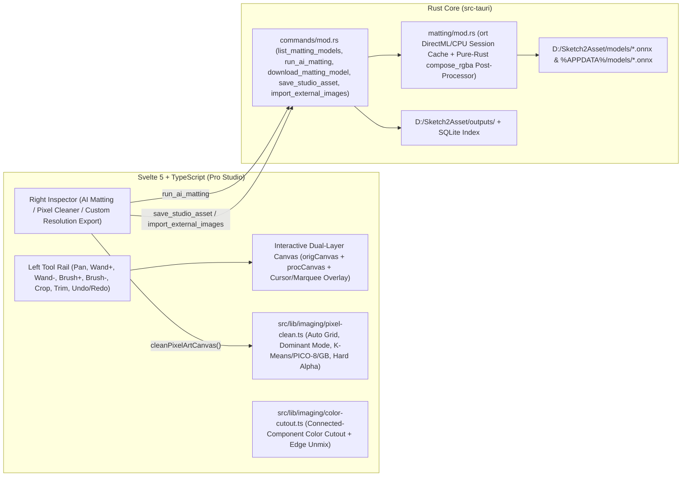

# V2 Phase 2: Pro Studio Workspace (AI Matting, Pixel Art Cleaner & Canvas Retouching) — Architecture & Design

## 1. System Architecture Overview

---

## 2. Backend Native AI Matting Engine (`src-tauri/src/matting/mod.rs`)

### 2.1 ONNX Runtime (`ort`) + DirectML Hardware Acceleration
- Uses `ort` (`2.0.0-rc.15`, `load-dynamic`, `directml`, `half`, `api-24`) with `onnxruntime.dll` + `DirectML.dll` placed alongside `bin/Sketch2Asset.exe` (and auto-discovered from `workspace_dir/bin`, `current_exe()` dir, or local Python `onnxruntime/capi`).
- Execution provider priority: **DirectML (GPU)** $\rightarrow$ **CPU**. Reports active execution provider (`DirectML (GPU)` or `CPU`) to the Studio UI badge.
- Sessions are lazily initialized and cached in a `Mutex<Option<CachedMattingSession>>` keyed by `(model_id, prefer_gpu)` so repeated matting calls execute instantaneously without reloading 200–500 MB ONNX graphs.

### 2.2 Model Registry & Dual-Directory Resolution
- Supports all 6 production matting models:
  1. `birefnet` (`birefnet-full-fp16.onnx`, 489 MB) — Flagship general & game asset matting
  2. `ben2` (`ben2-base.onnx`, 222 MB) — High-precision hair & fine silhouette edges
  3. `birefnet-hrsod` (`birefnet-hrsod-fp16.onnx`, 489 MB) — High-resolution salient object detection
  4. `birefnet-lite` (`birefnet-lite.onnx`, 224 MB) — Lightweight fast inference
  5. `isnet-general-use` (`isnet-general-use.onnx`, 178 MB) — Classic general object segmentation
  6. `isnetis` (`isnetis.onnx`, 176 MB) — Anime & 2D illustration specialist
- Resolves model files from both `workspace_dir.join("models")` (`D:\Sketch2Asset\models\`) and `app_data_dir.join("models")`, immediately recognizing the 6 pre-installed ONNX models in `D:\Sketch2Asset\models\` while supporting on-demand HTTP download for any missing model.

### 2.3 Pure-Rust `compose_rgba` Post-Processing Pipeline
Ported 1:1 from `matting_worker.py` into high-performance safe Rust:
1. **Background Color Estimation (`bgc`)**: Samples border pixels (`a < 0.1`, falling back to 4 corners) and computes per-channel median RGB.
2. **Optional Enhanced Recovery (`enhanced = true`)**:
   - Computes HSV-like chroma ($\max(R,G,B) - \min(R,G,B)$) and Euclidean color distance from `bgc`.
   - Identifies high-chroma (`chroma > 40` or `dist_bg > 100`) regions connected to confident foreground (`a > 0.7`, dilated by 45px) and rescues their alpha.
   - Tightens outer semi-transparent halo (`a < 0.1` dilated by 3px).
3. **Edge Choke (`choke: 0..=5`)**:
   - Iterative 4-neighbor cross minimum erosion on the alpha mask to shave stubborn bright fringes.
4. **Foreground Color Unmixing**:
   - For semi-transparent edge pixels ($0.02 < \alpha < 0.995$), solves:
     $$\text{RGB}_{\text{unmixed}} = \text{clamp}\left(\frac{\text{RGB} - (1 - \alpha)\cdot \text{BGC}}{\max(\alpha, 0.08)}, 0, 255\right)$$
   - Smoothly blends with original RGB via $\text{fade} = \text{clamp}(\alpha / 0.15, 0, 1)$.
5. **4px Game-Engine Color Bleed**:
   - Performs 4 iterations of 3×3 neighborhood color propagation from solid pixels ($\alpha > 0.6$) into transparent pixels ($\alpha = 0$) while keeping $\alpha = 0$, preventing dark/white bilinear sampling halos in Unity, Unreal, and Godot.

---

## 3. Frontend Pixel Art Cleaner (`src/lib/imaging/pixel-clean.ts`)

- **Auto Grid Periodicity Detection (`detectPixelBlockSize`)**: Evaluates candidate cell sizes (`[4, 6, 8, 10, 12, 14, 16, 20, 24, 32, 48, 64]`) over the central 80% region of the image and selects the block size minimizing intra-cell color variance.
- **Dominant Mode Color Voting**: Quantizes each cell's opaque pixels into 5-bit RGB bins (`32×32×32`) and assigns the mean color of the modal bin to the entire cell, guaranteeing 100% flat monochrome cells.
- **Palette Quantization**:
  - `auto` (lossless mode colors)
  - `16`, `32`, `64` colors via K-Means++ initialization + 4-iteration redmean perceptual distance clustering
  - `pico8` (official 16-color PICO-8 palette)
  - `gameboy` (classic 4-color DMG palette)
- **Single-Pixel Denoise & Dual Output**:
  - Removes isolated 1-cell noise surrounded by 4 identical orthogonal neighbors.
  - Produces both `canvas` (upscaled crisp nearest-neighbor at original resolution) and `nativeCanvas` (true 1:1 logical pixel grid, e.g., `64×64`, for direct game engine import).

---

## 4. Interactive Studio Canvas & Asset Workflow (`src/features/studio/StudioView.svelte`)

- **Dual-Canvas Architecture**:
  - `origCanvas`: Immutable reference layer of the source image (used for AI Matting input, Magic Wand flood-fill color reference, and Brush Restore source).
  - `procCanvas`: Active editable RGBA working layer rendered inside the zoom/pan viewport.
- **Interactive Retouching Tools**:
  - `pan`: Drag viewport (`Space` + drag or Middle Mouse button works in any tool).
  - `restore` (Magic Wand Restore): 4-connected flood fill seeded on `origCanvas` color within `tolerance` (`5..140`), restoring transparent pixels (`alpha < 128`) back to original RGBA.
  - `erase` (Magic Wand Erase): 4-connected flood fill seeded on `origCanvas` color within `tolerance`, erasing opaque pixels (`alpha >= 128`) to transparent.
  - `brushR` / `brushE` (Brush Restore / Brush Erase): Continuous interpolated circular stroke (`radius: 2..120px`) with live cursor ring preview on the canvas.
  - `crop` (Marquee Crop): Interactive bounding box with dimension badge and one-click `应用裁剪` (`Apply Crop`).
  - `Auto-Trim`: Computes alpha bounding box (`alpha > 8`) with `4px` safety padding and crops both layers in sync.
  - **Multi-step Undo / Redo (`Ctrl+Z` / `Ctrl+Y`)**: Stores up to 12 snapshots of `(width, height, procData, origData)`.
- **Seamless Integration with Asset Forge (`GenerateView.svelte`)**:
  - Asset cards, Lightbox modal, and custom right-click context menu include a **"送入工作台" (`Send to Studio`)** action that loads the selected asset directly into `StudioView` and switches the active view to `studio`.
  - Drag-and-drop external images (`.png`, `.jpg`, `.webp`, `.bmp`) into the Studio viewport imports them into the active project and loads the first image onto the workbench.
