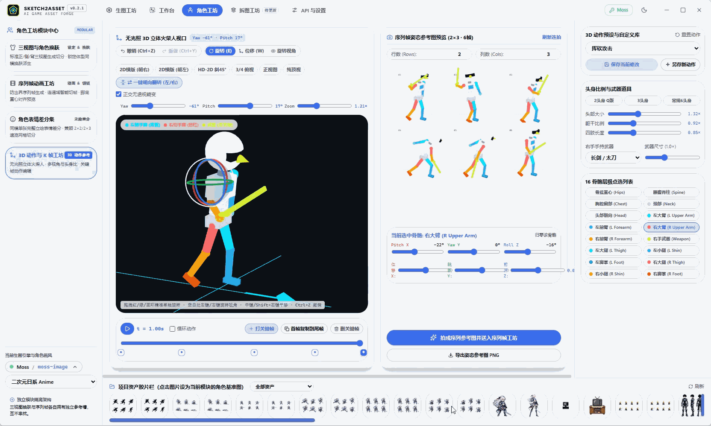
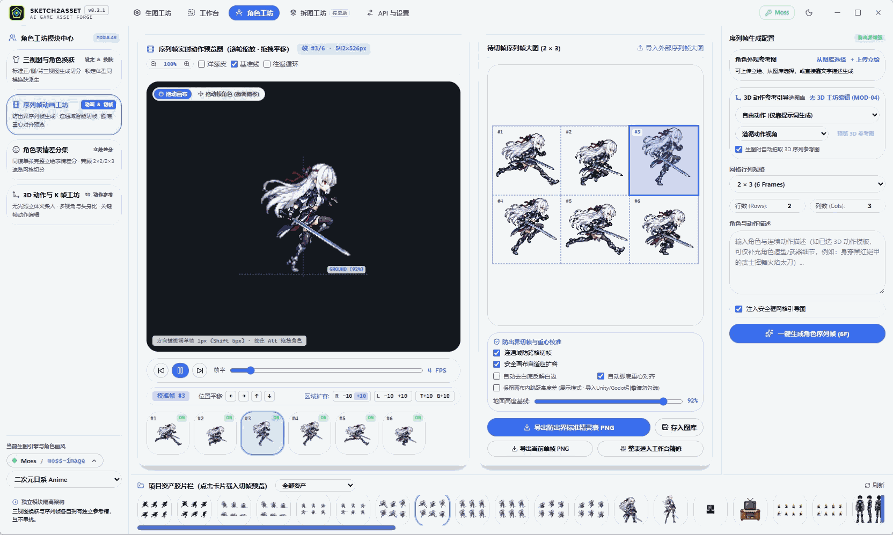
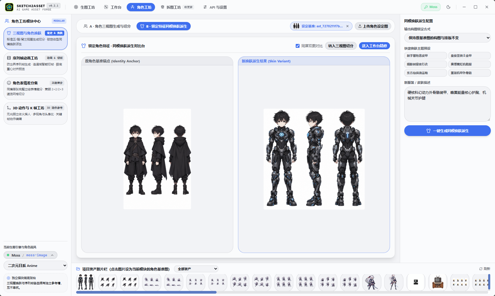
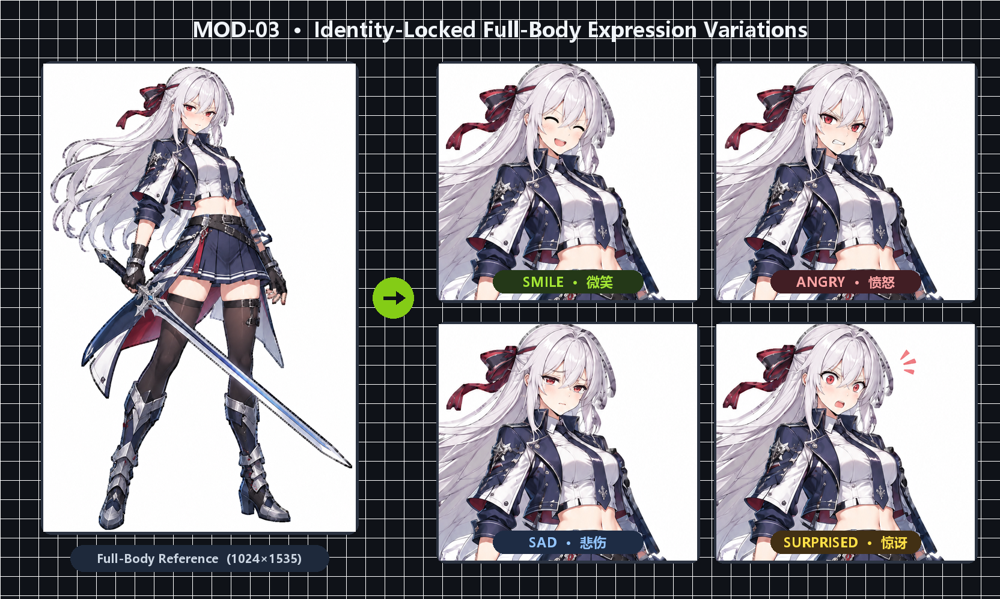
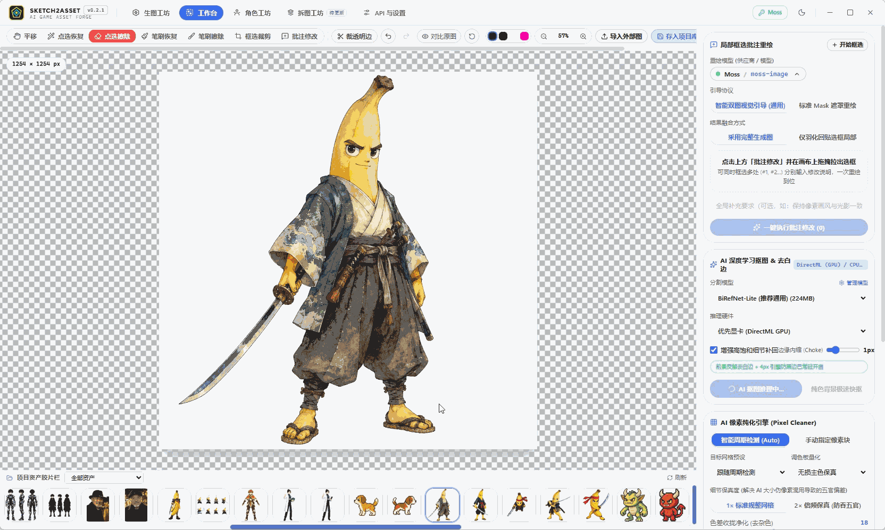
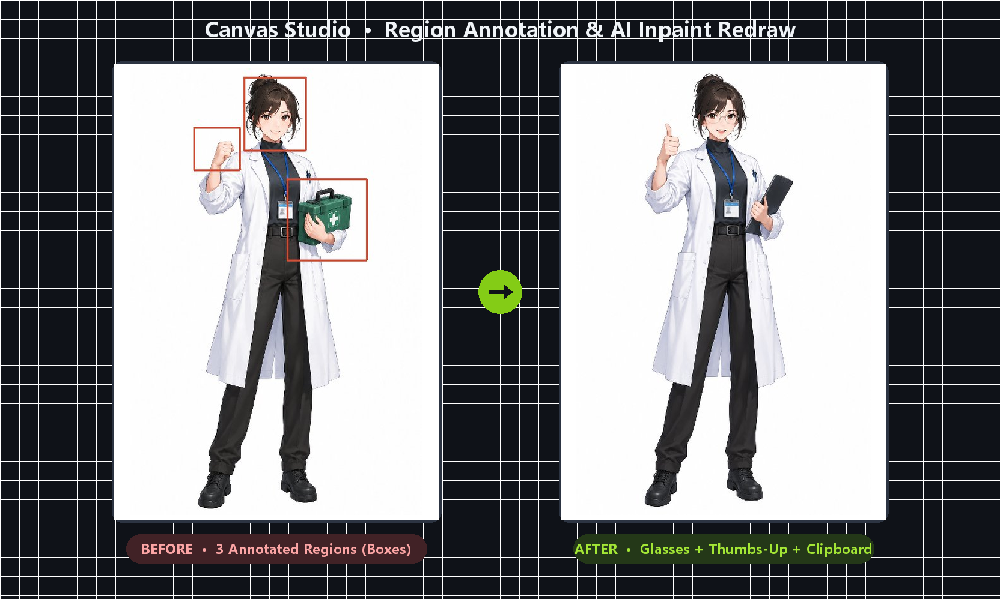
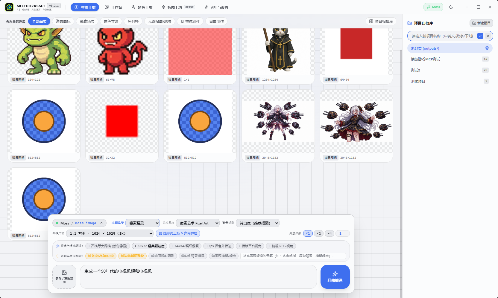
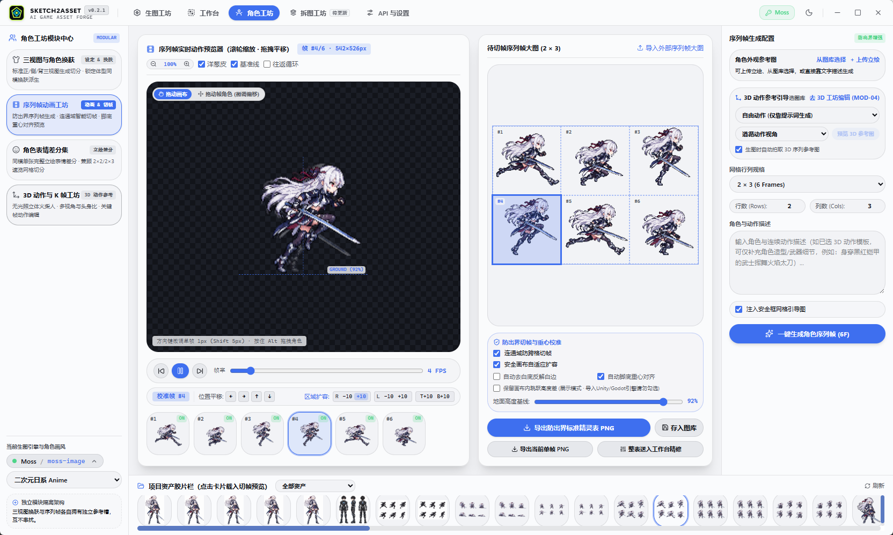
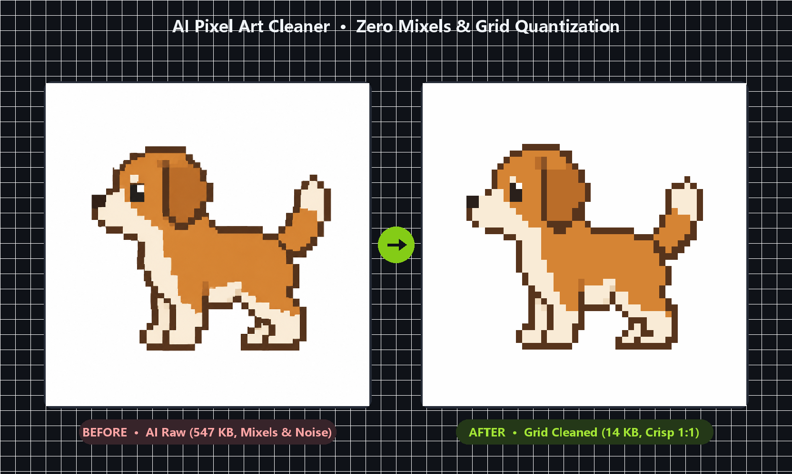
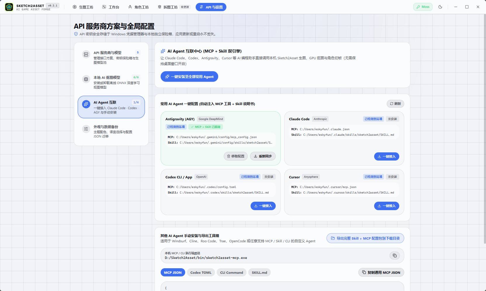

# Sketch2Asset — AI Game Asset Forge, 3D Pose K-Frame Studio & Native Matting Workstation

<p align="center">
  <b>An open-source native desktop workstation built for game developers, indie creators, and digital artists</b><br>
  Unifying structured asset generation, Three.js 3D pose keyframing, anti-clipping sprite sheet calibration, local DirectML GPU matting, pixel grid quantization, and AI Agent MCP integration into one production pipeline.
</p>

<p align="center">
  <b><a href="README.md">English</a></b> | <b><a href="README_zh.md">简体中文</a></b> | <b><a href="CHANGELOG.md">Changelog</a></b>
</p>

<p align="center">
  
  
  
  
  
  
  
  
</p>

---

## Why Sketch2Asset v0.3.1?

General-purpose AI image generators routinely fail at the **"last mile" of game production**:
- Sweeping sword slashes in sprite sheets breach uniform grid lines and get severed, or airborne jump frames float inside the texture and misalign Unity / Godot colliders;
- Flat 2D character illustrations cannot be rigged in Spine / Live2D without manually painting occluded back hair, inner coats, or facial parts layer by layer;
- Generated pixel art suffers from anti-aliasing blur and inconsistent sub-pixel "mixels", while transparent PNGs show ugly white halos under bilinear filtering;
- Workflows lack live two-way automation bridges to AI Coding Agents (Claude / Cursor / Antigravity) and local ComfyUI pipelines.

**Sketch2Asset** is built natively with **Tauri 2 + Rust + Svelte 5 + Three.js** with zero Python dependency for core asset generation, matting, and 3D posing (plus an optional one-click isolated CUDA extension for 2.5D character layer decomposition)—unifying structured generation, 3D pose guidance, sprite sheet calibration, DirectML GPU matting, 23+ layer PSD decomposition, and a Live Desktop MCP Bridge into one **Game-Ready** production pipeline.

---

## Feature Highlights

<table>
  <tr>
    <td width="50%" align="center">
      <b>1. MOD-04 · 3D Pose & Keyframe Studio</b><br>
      <sub>Unlit Three.js Capsule Rig · Unity-Style 3-Axis Gizmo · 8 Action Presets · Multi-Grid Export</sub><br><br>
      
    </td>
    <td width="50%" align="center">
      <b>2. MOD-02 · Anti-Clipping Sprite Slicer & Engine Pivot</b><br>
      <sub>Smart Island Slicing · Per-Frame Shift & Bounds Expand · In-Place Engine Alignment</sub><br><br>
      
    </td>
  </tr>
  <tr>
    <td width="50%" align="center">
      <b>3. MOD-01 · Turnaround Slicer & Identity-Locked Skinning</b><br>
      <sub>Projection-Valley Auto Slice · Click-to-Zoom Lightbox · Class/Armor Outfit Variants</sub><br><br>
      
    </td>
    <td width="50%" align="center">
      <b>4. MOD-03 · Expression & Portrait Variations</b><br>
      <sub>Batch Standalone Portraits from One Reference · Plus 2×2 / 2×3 / 3×3 Grid Slicing</sub><br><br>
      
    </td>
  </tr>
  <tr>
    <td width="50%" align="center">
      <b>5. Local DirectML GPU Matting & Anti-Halo Protection</b><br>
      <sub>BiRefNet / BEN2 / IS-Net Native Acceleration · Unmixing + Choke + 4px Color Bleed</sub><br><br>
      
    </td>
    <td width="50%" align="center">
      <b>6. Canvas Studio · Region Annotation & AI Inpaint Redraw</b><br>
      <sub>Draw Numbered Boxes (#1, #2) Directly on Canvas · Targeted AI Redraw & Auto-Composite</sub><br><br>
      
    </td>
  </tr>
</table>

---

## Workspace Panorama

### 1. Asset Forge — Structured Game Asset Generation

<p align="center">
  <!-- 📷 [Screenshot #3] Asset Forge full workspace with prompt dock, tags & project hub -->
  
</p>

- **7 Game Asset Archetypes**: Includes **`Sprite Sheet (sprite_sheet)`** alongside **Item Icon, Pixel Sprite, Character Card, Tile Texture, UI Element, and Free Mode**, automatically injecting production composition rules and modifier tags.
- **Checkerboard Pixel Canvas Guidance & Palette Lock *(v0.3.1 New)***: Automatically injects a micro-contrast `16`–`128` grid canvas (`Chroma` `#D6F8DC/#BAEAC3` for matting-free cutout + enclosed pocket cleanup, or `Neutral` `#F0F2F6/#DADEE4` for zero color cast), snaps every cell back to exact integer grids, and converges noisy AI gradients cleanly via salience-boosted `redmean` palette quantization (`Auto` / `16`–`64` / `Unlimited`).
- **Native Google Gemini & Rich Diagnostics *(v0.3.1 Fixed)***: Auto-routes `generativelanguage.googleapis.com` image models to native `:generateContent` (fixing Google's `/openai` mime-type 400 drops) and adds expandable full-JSON error inspection & copy modals.
- **Prompt Matrix & Negative Guardrails**: Expand `[fire|ice|lightning]` × `[greatsword|staff]` into up to 16 parallel variants; toggle 5 game-ready negative guardrails with one click.
- **Project Style Anchors & Region Annotations**: Lock a project-wide Style Prompt and up to 4 reference anchors, or draw numbered bounding boxes (`#1`, `#2`...) directly on reference images for targeted edits.

---

### 2. Character Workshop — 3D Pose, Turnarounds, Sprite Sheets & Expressions

<p align="center">
  <!-- 📷 [TODO Screenshot] Character Workshop full view (save as docs/media/character-workshop.png) -->
  
</p>

- **`MOD-01` Turnaround & Identity-Locked Skinning**: Generates horizontally aligned front/side/back views with projection-valley slicing, **click-to-zoom Lightbox inspection**, and identity-locked outfit variants.
- **`MOD-02` Sprite Sheet Studio**:
  - **3D Pose Reference Driven**: Uses multi-cell pose sheets rendered from `MOD-04` instead of brittle text-only action templates.
  - **Engine In-Place Alignment (Default)**: Defaults to `preserveVerticalArc = false` so jump/action frames align cleanly with game engine physics colliders, while keeping an optional preview-arc toggle.
  - **Smart Island Slicing & Dual-Channel Calibration**: Preserves sweeping sword slashes & VFX intact; supports per-frame arrow-key / drag nudging, `R/L/T/B` bounds expansion, highlighted filmstrip scrollbars, and **right-click context menus**.
- **`MOD-03` Expression Generator**: Prioritizes generating multiple standalone full character portraits from a single reference for dialogue/AVG pipelines, while retaining `2×2` / `2×3` / `3×3` grid slicing.
- **`MOD-04` 3D Pose & Keyframe Studio** *(v0.2.1 New)*:
  - Unlit Three.js capsule rig (18+ hierarchical bones, side-scroller L/R, HD-2D 45°, 3/4, front, and top views) with 2-head chibi / 3-head / 6-head proportions and weapon props.
  - 8 handcrafted action templates (Idle, Walk, Run, Attack, Cast, Jump, Hit, KO), Unity-style 3-axis spherical rotation Gizmo, `W/E` translate/rotate switching, 50-step `Ctrl+Z/Y` undo/redo, and one-click capture into `MOD-02`.

---

### 3. Canvas Studio — Native GPU Matting & Pixel Quantizer

<p align="center">
  
</p>

- **Upgraded Halo-Free Matting & Dual-Plate Triangulation *(v0.3.1 Upgraded)***: Combines `f32` bilinear mask upscaling, 3-channel RGB **Fast Guided Image Filtering**, **Multi-Level Foreground/Background Estimation** (`estimate_foreground_ml`), and isotropic sub-pixel edge choke; plus one-click **Dual-Plate True Alpha** (Smith-Blinn white/black triangulation) for translucent glass, fire, smoke, and fine white hair.
- **Residual Grid + `k-Centroid` Pixel Snapper *(v0.3.1 Overhauled)***: Uses Reconstruction-Residual `(step, phase)` grid locking (`Uniform` zero-warp & `Adaptive` modes), per-cell OKLAB `k-Centroid (k=2)` medoid voting (100% lossless on already crisp pixel art), and optional OKLAB collinear sandwich AA stripping.
- **DirectML GPU AI Matting**: Powered by Rust `ort` + ONNX Runtime DirectML (NVIDIA / AMD / Intel out of the box, zero Python/CUDA) with 6 downloadable models:

<details>
<summary>Expand to view the 6 built-in matting models & 3-stage anti-halo pipeline</summary>

| Model ID | Size / Precision | Best For |
| :--- | :--- | :--- |
| **`birefnet`** | ~490 MB (FP16) | **Flagship SOTA**: Complex silhouettes, hollow props, and semi-transparent edges |
| **`ben2`** | ~220 MB | Next-gen balanced model combining fast inference with crisp boundaries |
| **`birefnet-hrsod`** | ~490 MB (FP16) | High-resolution detail specialist for large character illustrations |
| **`birefnet-lite`** | ~220 MB | Lightweight model for low-spec hardware or rapid previews |
| **`isnet-general-use`** | ~178 MB | Ultra-fast general purpose matting for clean icon batches |
| **`isnet-anime`** | ~176 MB | Specialized for 2D anime characters, hair strands, and cel lineart |

- **3-Stage Anti-Halo Protection**: Foreground Color Unmixing → Alpha Edge Choke (`0~3px`) → 4px Export Color Bleed.
- **7 Interactive Tools**: Wand Flood Restore/Erase, Brush Restore/Erase, Marquee Crop & Auto-Trim, Region Annotation AI Redraw, 4 backdrops (including `#FF00FF` Engine Magenta), and 40-step history.

</details>

---

### 4. Layer Decompose Workshop — 2.5D Semantic Splitting & Unity 2D Gizmo *(v0.3.0 New)*

- **23+ Occluded Semantic Layers & Layered `.psd`**: Powered by optional isolated **See-Through** (`LayerDiff3D` + `Marigold Depth`) CUDA extension with one-click Python 3.12 runtime provisioning, 8-way parallel mirror downloads (`NF4` 4-bit / `BF16`), and automatic DirectML VRAM handoff.
- **Unity-Style 2D XY Move Gizmo**: Zoom-invariant red X arrow, green Y arrow, and blue XY free-drag handle, with `Q`/`W` tool switching, `1 / 5 / 20px` arrow-key nudging, Z-order reordering, and baked offsets on `.psd` / bundle export.
- **Secondary Splitting & 4-Pass Fidelity**: Split any layer Left/Right (`-l`/`-r`) or Depth Front/Back (`-back`/`-front` with occluded band inpainting), defringe halos, recover missing footwear/headwear, calibrate Live2D facial Z-order & skin fidelity, and send any part directly to Canvas Studio.
- **Smart Hardware Protection**: Auto-skips redundant BiRefNet matting when alpha transparency already exists, adapts Group/CPU Offload to free VRAM, and defaults to `cool_ms: 60` thermal protection across both UI and MCP.

---

### 5. AI Agent Hub (MCP), ComfyUI & Native Desktop Polish

<p align="center">
  <!-- 📷 [Screenshot #4] Settings -> AI Agent Hub or ComfyUI Workflow configuration -->
  
</p>

- **Live Desktop MCP Bridge & Async Server (`sketch2asset-mcp.exe`)** *(v0.3.0 Upgraded)*:
  - Exposes **13 MCP tools** (asset forge, GPU matting, character turnarounds/spritesheets/expressions, live 3D pose editing/rendering, region redraw, project management, plus `s2a_decompose_status` and async-by-default `s2a_decompose_character` so 2.5D decomposition never hits 3-minute MCP timeouts).
  - **Real-Time UI Synchronization**: Authenticated localhost TCP bridge routes MCP actions straight into the open `Sketch2Asset.exe` window—automatically switching views, showing live progress, and letting users pause or abort Agent tasks directly in the UI.
  - **One-Click Setup**: Built-in **AI Agent Hub** in Settings generates and installs `mcpServers` configs and updated `SKILL.md` bundles for Claude Desktop, Cursor, Antigravity, OpenCode, and more.
- **Local ComfyUI Workflow Integration**: Connect local ComfyUI endpoints, import custom workflow JSONs, and map Prompt / Size / Batch / Steps / Reference Image nodes.
- **Native Windows Desktop Experience**: Single-instance window guard, System Tray minimization (`ask` / `tray` / `exit`), TitleBar update pill, and **in-app lightweight incremental patch updater** (`v0.2.2+`).
- **AppData & DPAPI Security**: Credentials encrypted via Windows DPAPI; all library data, scoped extension installs, and models isolated cleanly.

---

## Local Development & Build

<details>
<summary>Expand for prerequisites, build commands, and repository structure</summary>

### 1. Prerequisites
- **OS**: Windows 10 / 11 (x64)
- **Frontend**: [Node.js](https://nodejs.org/) >= 18, [pnpm](https://pnpm.io/) >= 9
- **Backend**: [Rust](https://www.rust-lang.org/) >= 1.75 (MSVC toolchain)

### 2. Commands
```bash
# Install frontend dependencies
pnpm install

# Launch Tauri desktop window with HMR
pnpm tauri dev

# Strict diagnostics & unit tests
pnpm check
cargo test --manifest-path src-tauri/Cargo.toml --lib

# Production build (app + standalone MCP binary)
pnpm build
cargo build --release --manifest-path src-tauri/Cargo.toml --features tauri/custom-protocol
```

### 3. Repository Structure
```text
sketch2asset/
├── src/                                  # Svelte 5 frontend source
│   ├── features/
│   │   ├── generate/                     # Asset Forge (7 archetypes, prompt matrix, annotations)
│   │   ├── character/                    # Character Workshop (MOD-01 ~ MOD-04)
│   │   ├── studio/                       # Canvas Studio (GPU matting, pixel cleaner, wand/brush)
│   │   ├── decompose/                    # Layer Decompose Workshop (2.5D PSD & 2D XY Gizmo)
│   │   └── settings/                     # Settings (Providers, ComfyUI, AI Agent Hub, Tray, Updater)
│   └── lib/
│       ├── components/                   # TitleBar (version/updater/nav), close dialog, etc.
│       ├── imaging/                      # Island slicer, foot pivot, pixel cleaner, unmixing
│       ├── i18n/                         # Reactive ZH/EN dictionary
│       └── stores/                       # Reactive state & library_revision sync
├── src-tauri/                            # Tauri 2 + Rust backend + MCP binary
│   └── src/
│       ├── bin/mcp.rs                    # sketch2asset-mcp standalone MCP server
│       ├── commands/                     # IPC commands, Agent Hub & incremental updater
│       ├── decompose/                    # Extension installer, 8-way downloader & See-Through worker
│       ├── library/                      # SQLite 3 (WAL) repository & revision tracking
│       ├── matting/                      # ONNX Runtime (DirectML) & anti-halo pipeline
│       ├── mcp/                          # MCP 13-tool executor, TCP desktop bridge & SKILL.md hub
│       └── providers/                    # OpenAI Images / Chat / ComfyUI clients
├── docs/media/                           # README screenshots & demo GIFs
├── CHANGELOG.md                          # Version release notes
└── package.json
```

</details>

---

## Acknowledgments

Special thanks to the **[LINUX DO](https://linux.do/)** community and all developers, creators, and testers whose feedback, discussions, and support made this release possible!

## License

Released under the [MIT License](LICENSE). Free for both personal indie projects and commercial game development.
