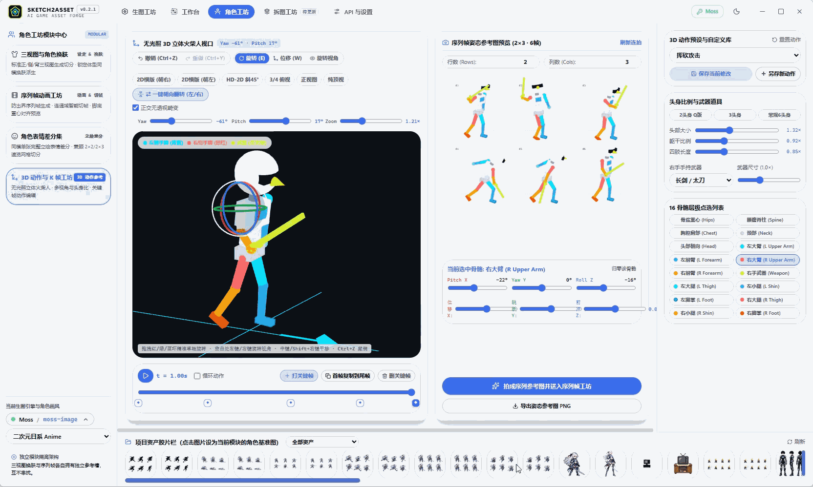
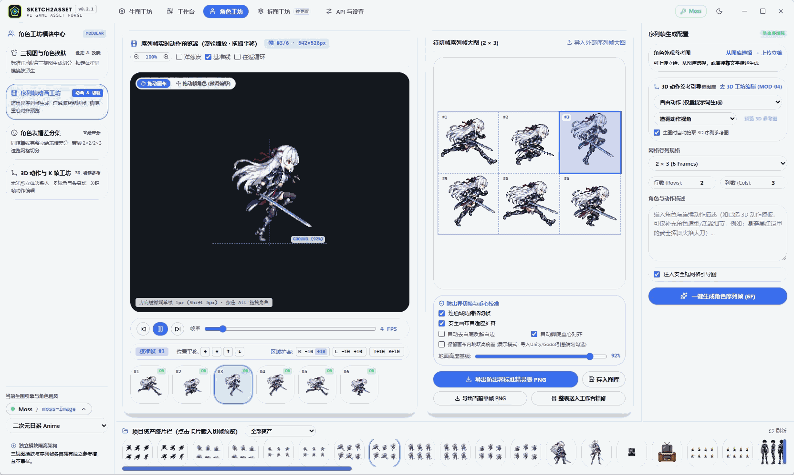
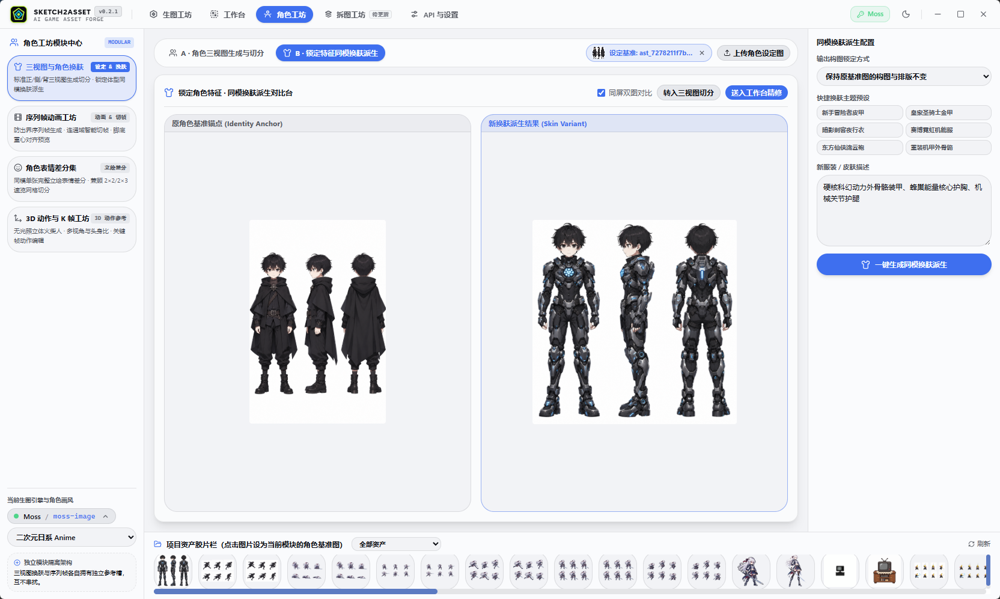
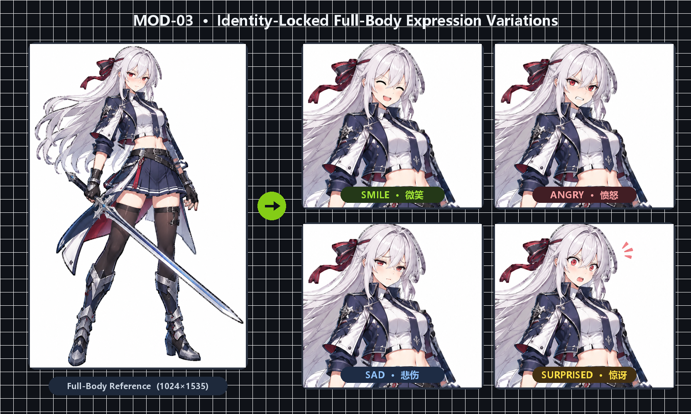
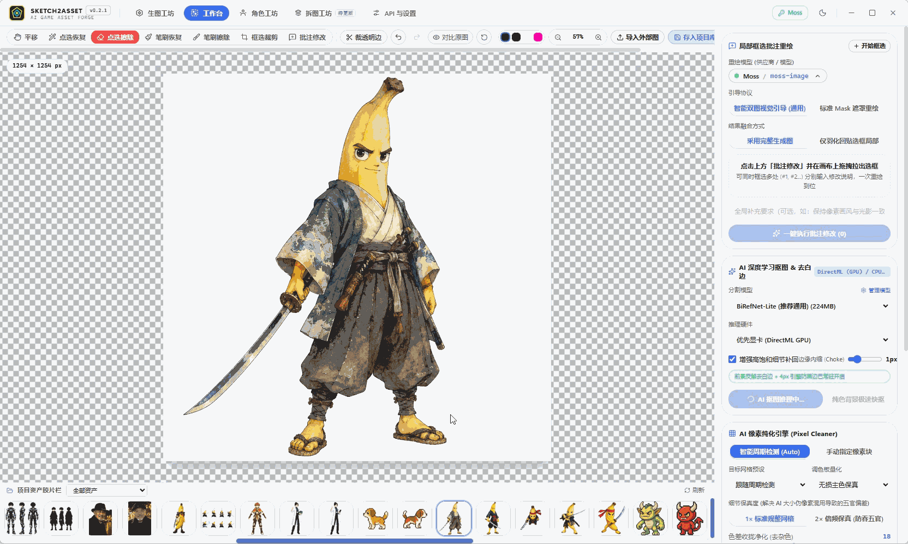
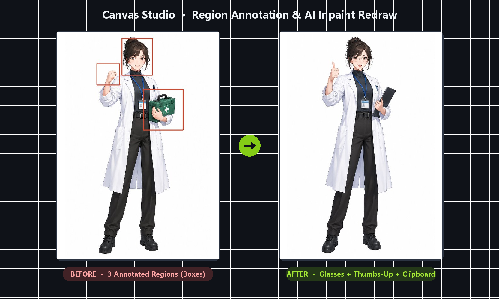
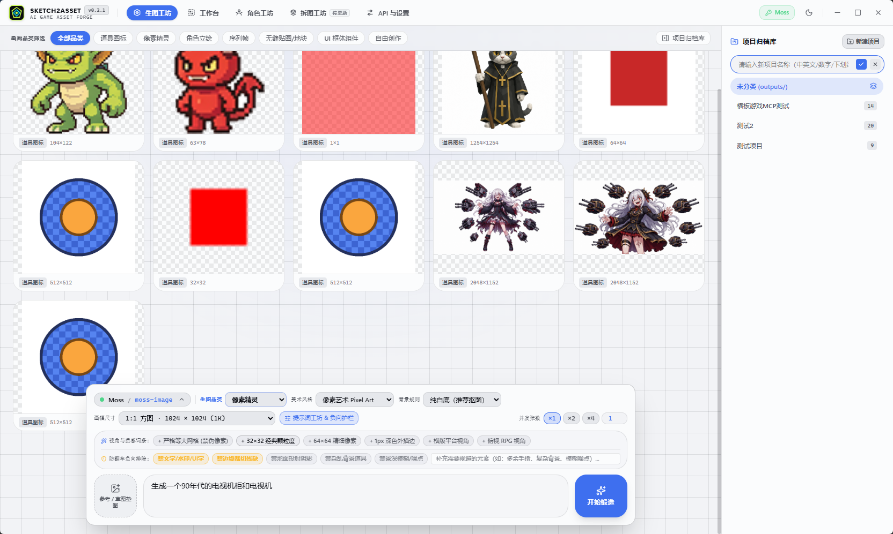
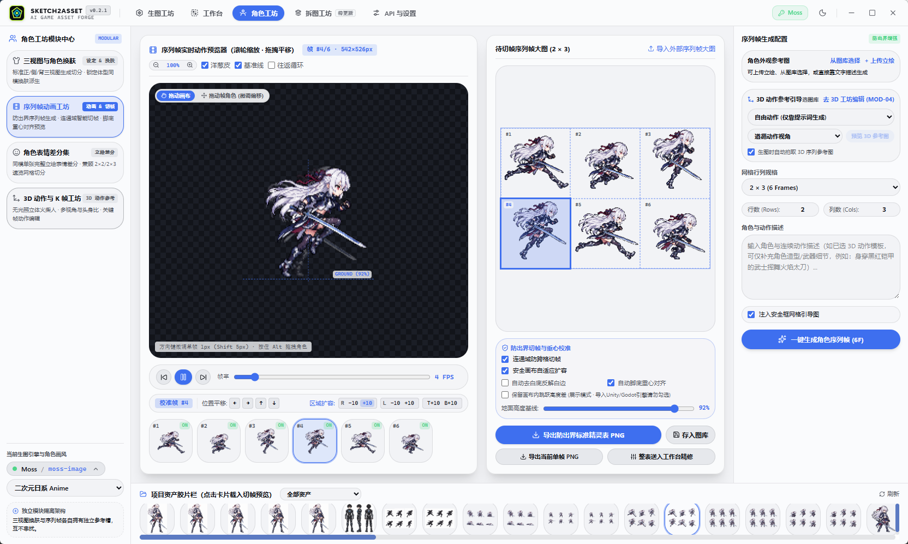
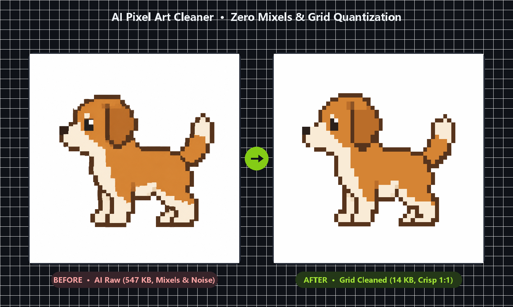
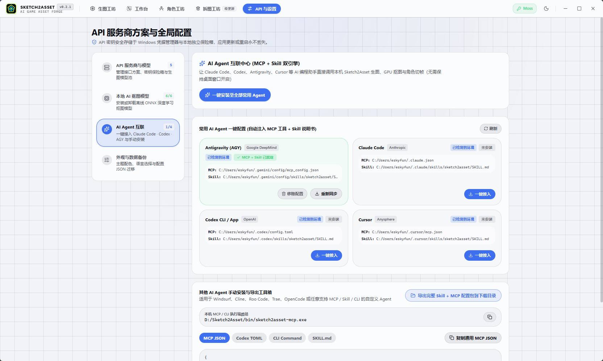

# Sketch2Asset — AI 游戏资产锻造、3D 动作 K 帧与原生修图工作站

<p align="center">
  <b>专为游戏开发者、独立制作人与美术设计师打造的开源原生桌面工作站</b><br>
  集结构化提示词生图、3D 骨骼动作 K 帧引导、防出界序列帧校准、本地 DirectML GPU AI 抠图、像素网格纯化与 AI Agent MCP 协议互联于一体的全链路 2D 游戏资产生产工具.
</p>

<p align="center">
  <b><a href="README.md">English</a></b> | <b><a href="README_zh.md">简体中文</a></b> | <b><a href="CHANGELOG.md">更新日志 (Changelog)</a></b>
</p>

<p align="center">
  
  
  
  
  
  
  
</p>

---

## 为什么选择 Sketch2Asset v0.2.1？

通用 AI 生图工具在面对实际游戏开发管线时，往往卡在“最后 1 公里”：
- 序列帧挥刀跨过网格线被拦腰截断，或角色跳跃帧在贴图内部强行浮空导致 Unity / Godot 碰撞体错位；
- 生成的像素图带有扩散抗锯齿杂色与大小不一的“伪像素（Mixels）”；
- 透明 PNG 导入游戏引擎后，在双线性过滤下边缘泛起一圈白边；
- 缺少与 AI Coding Agent（Claude / Cursor / Antigravity）以及本地 ComfyUI 工作流的自动化打通。

**Sketch2Asset** 采用 **Tauri 2 + Rust + Svelte 5 + Three.js** 纯原生桌面架构打造，零 Python 环境依赖，将**生图、3D 动作引导、序列帧引擎级校准、GPU 抠图与 MCP 自动化**整合为一套可直接投入生产的 **Game-Ready** 资产管线。

---

## 亮点功能演示（Highlights）

<table>
  <tr>
    <td width="50%" align="center">
      <b>1. MOD-04 · 3D 动作与 K 帧工坊</b><br>
      <sub>Three.js 无光照胶囊人偶 · Unity 风格三轴球面 Gizmo · 8 套动作模板 · 多视角一键拍图</sub><br><br>
      
    </td>
    <td width="50%" align="center">
      <b>2. MOD-02 · 防出界序列帧校准与引擎对齐</b><br>
      <sub>连通域防跨格切帧 · 单帧位置/扩容双通道微调 · 引擎原地对齐（告别碰撞体漂移）</sub><br><br>
      
    </td>
  </tr>
  <tr>
    <td width="50%" align="center">
      <b>3. MOD-01 · 正侧背三视图切分与同模换肤</b><br>
      <sub>像素波谷自动切分 · Lightbox 点击放大 · 锁定人物五官体型的装备/时装换肤</sub><br><br>
      <!-- 📷 [三视图切分与同模换肤] -->
      
    </td>
    <td width="50%" align="center">
      <b>4. MOD-03 · 单张立绘表情与姿态差分</b><br>
      <sub>锁定角色一致性批量派生喜怒哀乐立绘 · 兼顾 2×2 / 2×3 / 3×3 速览网格切分</sub><br><br>
      
    </td>
  </tr>
  <tr>
    <td width="50%" align="center">
      <b>5. 本地 DirectML GPU AI 抠图与三阶去白边</b><br>
      <sub>BiRefNet / BEN2 / IS-Net 原生硬件加速 · 前景色反解 + Choke + 4px 色彩外扩</sub><br><br>
      
    </td>
    <td width="50%" align="center">
      <b>6. 工作台 · 局部框选批注 AI 定向重绘</b><br>
      <sub>画布直接拉框标记 #1/#2 修改区域 · 精准局部修补并自动回填当前图层</sub><br><br>
      <!-- 📷 [工作台局部框选 AI 重绘] -->
      
    </td>
  </tr>
</table>

---

## 核心工坊全景

### 一、 资产锻造工坊（Asset Forge）— 结构化游戏资产生成

<p align="center">
  <!-- 📷 [截图占位 #3] 生图工坊完整界面（含底部指令舱、修饰词标签与右侧项目归档库） -->
  
</p>

- **7 大游戏资产原型（Archetypes）**：新增 **`序列帧（sprite_sheet）`** 品类，连同 **道具图标、像素精灵、角色立绘、无缝地表贴图、UI 组件、自由创作**，切换时自动注入构图规范与专属修饰词标签。
- **变量矩阵与负面护栏**：支持 `[火焰|寒冰|雷电]` × `[巨剑|法杖]` 笛卡尔积最多 16 组并发裂变生成；内置 5 大游戏级负面护栏（禁文字水印、禁边缘裁切、禁地面投射阴影等）。
- **项目风格锚定与多图框选批注**：支持绑定项目全局 Style Prompt 与最多 4 张风格参考锚定图；可在参考图上直接拉框编号（`#1`、`#2`...）并写局部修改指令。

---

### 二、 角色工坊（Character Workshop）— 3D 引导、三视图、序列帧与表情

<p align="center">
  <!-- 📷 [待补充截图] 角色工坊完整界面（推荐截取 MOD-01/MOD-04 界面，保存为 docs/media/character-workshop.png） -->
  
</p>

采用模块化架构，围绕单个角色衍生全套可进引擎的游戏资源：

- **`MOD-01` 三视图与同模换肤**：自动生成水平对齐的正/侧/背三视图并按像素波谷智能切分；**支持点击三视图卡片高清 Lightbox 放大查看与翻页**；锁定人物五官体型的同模换装换肤。
- **`MOD-02` 序列帧动画工坊**：
  - **3D 动作参考驱动**：接入 `MOD-04` 导出的多格 3D 姿势引导图替代纯文本预设，大幅提升动作连贯性与透视一致性。
  - **游戏引擎原地对齐（默认）**：`preserveVerticalArc = false` 默认将跳跃/动作帧对齐到角色脚底与物理碰撞体中心（杜绝 Unity/Godot 碰撞体与贴图分离），同时保留「预览抛物线」开关供静态展示使用。
  - **连通域防跨格切帧 + 双通道微调**：刀光/披风跨格自动追踪不断裂，未开自动去底时 100% 保护特效不穿孔；支持单帧 `← → ↑ ↓` 拖拽/方向键平移与 `R / L / T / B` 采样框扩容，底部胶片栏支持高亮滚动条与**右键二级菜单**。
- **`MOD-03` 角色表情差分集**：以**基于单张立绘批量生成多张完整角色立绘**为主模式（更贴合 AVG 对话立绘生产），同时兼容 `2×2` / `2×3` / `3×3` 速览网格切分。
- **`MOD-04` 3D 动作与 K 帧工坊** *(v0.2.1 New)*：
  - 基于 Three.js 构建 18 节以上完整骨骼胶囊人偶（横板朝右/朝左、HD-2D 斜 45°、3/4 俯视、正视、纯顶视），支持 2 头身 Q 版 / 3 头身 / 常规 6 头身与武器尺寸调节。
  - 内置 **Idle / Walk / Run / Attack / Cast / Jump / Hit / KO** 8 套手工动作，支持 Unity 风格三轴球面旋转 Gizmo、`W/E` 切换移动/旋转、50 步 `Ctrl+Z/Y` 撤销重做、关键帧插值播放，以及一键拍图送入 `MOD-02`。

---

### 三、 精修与像素纯化工坊（Canvas Studio）— 原生 GPU 抠图与像素重塑

<p align="center">
  
</p>

- **本地 DirectML GPU AI 抠图**：基于 Rust `ort` + ONNX Runtime DirectML，免 Python / CUDA，开箱支持 NVIDIA / AMD / Intel 显卡加速，内置 6 款模型在线一键管理：

<details>
<summary>展开查看 6 款内置 AI 抠图模型与三阶去白边管线详情</summary>

| 模型 ID | 体积 / 精度 | 适用场景说明 |
| :--- | :--- | :--- |
| **`birefnet`** | ~490 MB (FP16) | **SOTA 旗舰首选**：复杂轮廓、镂空结构、半透明材质分割精度最高 |
| **`ben2`** | ~220 MB | 新一代均衡模型，兼顾极快推理速度与锐利边缘质量 |
| **`birefnet-hrsod`** | ~490 MB (FP16) | 高分辨率细节特化版，适合精细立绘与大型概念图 |
| **`birefnet-lite`** | ~220 MB | 轻量高速版，适合低配设备或快速预览 |
| **`isnet-general-use`** | ~178 MB | 极速通用版，适合简单白底道具图标快速抠图 |
| **`isnet-anime`** | ~176 MB | 二次元/动漫角色特化模型，发丝与赛璐璐线条保留出色 |

- **游戏引擎级去白边三阶保护**：物理前景色反解（Foreground Unmixing）→ Alpha 边缘内缩（Choke 0~3px）→ 导出 4px 边缘色彩外扩（Color Bleed）。
- **7 大交互修补工具**：魔棒找回/擦除、自由笔刷、选区裁剪与 Auto-Trim、区域框选批注 AI 局部重绘、4 种检验底色（含 `#FF00FF` 品红底）与 40 步历史栈。

</details>

---

### 四、 AI Agent 互联中心（MCP）、ComfyUI 与桌面原生体验

<p align="center">
  <!-- 📷 [截图占位 #4] 设置页 -> AI Agent 互联中心或 ComfyUI 工作流连接界面 -->
  
</p>

- **独立 MCP Server (`sketch2asset-mcp.exe`)** *(v0.2.1 New)*：
  - 提供 **11 个标准 MCP 工具**（生图、GPU 抠图、角色三视图/序列帧派生、读取与编辑 `MOD-04` 3D 动作并实时桌面渲染、局部框选重绘、项目管理）。
  - **实时双端同步**：桌面端设置修改实时落盘供 MCP 读取；前端每 2.5 秒静默轮询 `library_revision`，AI Agent 生成的资产无需手动切换界面即可自动出现在工作台/角色工坊。
  - **一键接入引导**：支持在设置页直接查看/安装/复制 Claude Desktop、Cursor、Antigravity 等客户端的 `mcpServers` 配置。
- **ComfyUI 本地工作流直连** *(v0.2.1 New)*：支持配置本地 ComfyUI 地址与连通性测试，导入自定义工作流 JSON 并映射 Prompt、宽高、Batch Size、采样步数与参考图节点。
- **原生 Windows 系统托盘与更新提醒** *(v0.2.1 New)*：支持最小化到系统托盘、关闭窗口询问记忆（每次询问 / 最小化到托盘 / 直接退出）、顶栏实时版本号显示及新版本 SemVer 检测提示。
- **拆图工坊（Decompose · 即将推出）**：顶部导航栏已预留入口，后续版本将接入透明图层拆解管线。
- **系统级数据安全隔离**：API Key 经 Windows 原生凭据管理器（DPAPI）加密；全部项目库与模型隔离存放于 `%AppData%\com.sketch2asset.app`。

---

## 本地开发与构建

<details>
<summary>展开查看环境依赖、开发命令与工程目录结构</summary>

### 1. 环境依赖
- **操作系统**：Windows 10 / 11 (x64)
- **前端工具链**：[Node.js](https://nodejs.org/) >= 18，[pnpm](https://pnpm.io/) >= 9
- **后端工具链**：[Rust](https://www.rust-lang.org/) >= 1.75 (MSVC toolchain)

### 2. 开发与构建命令
```bash
# 安装前端依赖
pnpm install

# 启动 Tauri 桌面开发窗口（支持热重载）
pnpm tauri dev

# 严格类型检查与后端单元测试
pnpm check
cargo test --manifest-path src-tauri/Cargo.toml --lib

# 构建生产包与独立 MCP 二进制
pnpm build
cargo build --release --manifest-path src-tauri/Cargo.toml --features tauri/custom-protocol
```

### 3. 工程目录结构
```text
sketch2asset/
├── src/                                  # Svelte 5 前端源码
│   ├── features/
│   │   ├── generate/                     # 资产锻造工坊（7 大品类、变量矩阵、多图批注）
│   │   ├── character/                    # 角色工坊（MOD-01 ~ MOD-04：三视图/序列帧/表情/3D K 帧）
│   │   ├── studio/                       # 精修工坊（GPU 抠图、像素纯化、魔棒/笔刷、框选重绘）
│   │   └── settings/                     # 设置中心（API 供应商、ComfyUI、AI Agent 互联、托盘设置）
│   └── lib/
│       ├── components/                   # 标题栏（版本/更新提示/拆图占位）、关闭弹窗等
│       ├── imaging/                      # 连通域切片、脚底重心对齐、像素纯化、前景色反解
│       ├── i18n/                         # 中英双语响应式字典
│       └── stores/                       # 全局状态与库版本自动同步流
├── src-tauri/                            # Tauri 2 + Rust 后端 + 独立 MCP Binary
│   └── src/
│       ├── bin/mcp.rs                    # sketch2asset-mcp 独立 MCP 服务端
│       ├── commands/                     # IPC 命令与 Agent Hub 集成
│       ├── library/                      # SQLite 3 (WAL) 资产库与 revision 追踪
│       ├── matting/                      # ONNX Runtime (DirectML) 推理与去白边后处理
│       └── providers/                    # OpenAI Images / Chat / ComfyUI 多协议客户端
├── docs/media/                           # README 截图与 GIF 演示素材
├── CHANGELOG.md                          # 版本更新日志
└── package.json
```

</details>

---

## 鸣谢

特别鸣谢 **[LINUX DO](https://linux.do/)** 社区以及所有在开发、重构、模型测试与游戏管线调优过程中提供灵感、技术讨论与无私支持的伙伴们！

## 开源协议

本项目基于 [MIT License](LICENSE) 开源，可自由用于个人独立游戏与商业游戏项目开发。
